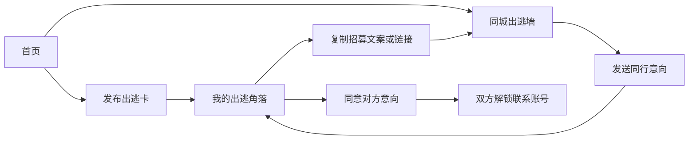
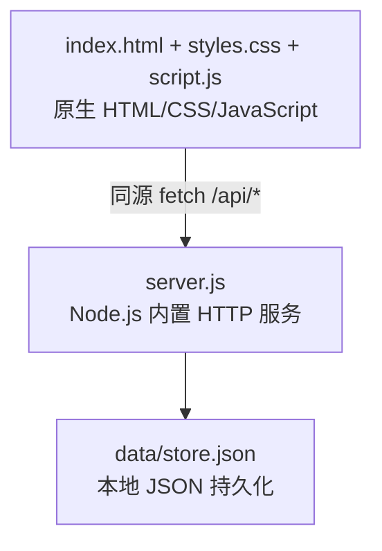
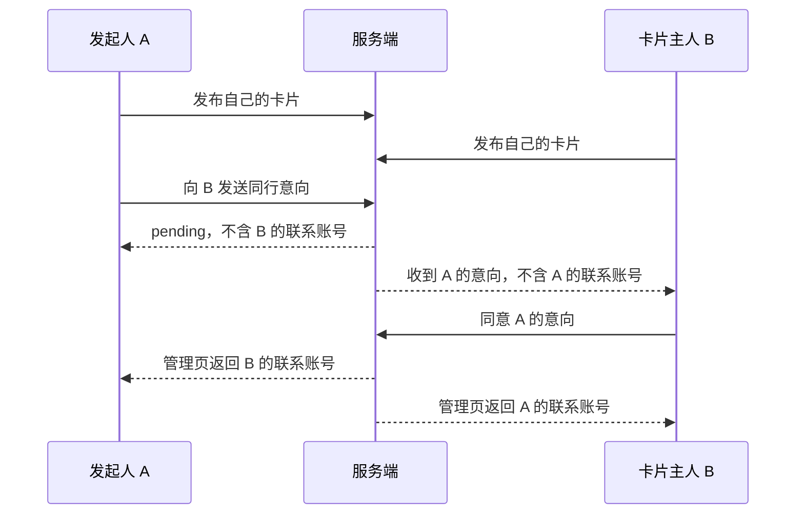

# 设计说明：周末出逃搭子配对器

本文记录**当前已实现的设计**。计划中的改进见 [improve.md](./improve.md)，本地运行方式见 [README.md](./README.md)。

## 1. 产品原则

- **计划先行：** 用“哪天、从哪出发、去做什么、预算多少”组织发现和配对，而不是只展示个人简介。
- **双向同意：** 公开列表不返回联系方式；只有形成双方意向后才在各自管理页返回对方账号。
- **空状态真实：** 没有真实卡片就显示空墙，不使用虚构搭子充数。
- **小步闭环：** 不代替即时聊天或支付；配对完成后，双方转到自己选择的社媒继续沟通。

## 2. 信息架构与交互

### 主要状态

| 对象 | 状态 | 当前行为 |
| --- | --- | --- |
| 出逃卡 | 招募中 | 日期未过时出现在公开列表，可收到意向 |
| 出逃卡 | 已停止招募 | 从公开列表隐藏；管理页仍可查看 |
| 出逃卡 | 已过期 | 日期早于中国时区当日时，不再出现在公开列表 |
| 意向 | `pending` | 只有双方的公开卡片信息，不返回对方账号 |
| 意向 | `accepted` | 各自在管理页看到对方的联系平台和账号 |

当前没有“拒绝”“撤回”“重新开启”状态，也没有过期数据自动清理；这些属于待改进项。

## 3. 技术结构

- **前端：** 单页应用，无打包步骤。表单提交、筛选、意向和管理操作通过同源 API 完成；动态用户内容在插入 HTML 前转义。
- **服务端：** Node.js 20+，无第三方运行依赖；默认监听 `127.0.0.1:4173`。
- **存储：** 启动时读入 JSON，写入时先写临时文件再重命名。适合单进程、小数据量使用；不适合多实例并发部署。
- **身份凭证：** 创建卡片时生成 32 字节随机管理口令，以 64 位十六进制字符串返回。浏览器保存在 `localStorage`，后续以 `Authorization: Bearer <口令>` 访问自己的数据。用户可手动备份并在另一浏览器找回。

## 4. 数据模型

### Card

| 字段 | 用途 | 公开列表可见 |
| --- | --- | --- |
| `id` | 卡片 UUID、分享链接定位 | 是 |
| `nickname`, `city`, `destination` | 昵称、出发城市、计划 | 是 |
| `date`, `time` | 出行日期与出发时间描述 | 是 |
| `vibe`, `pace`, `budget`, `intro` | 主题、节奏、预算、说明 | 是 |
| `createdAt`, `open` | 创建时间与招募开关 | 是 |
| `contactType`, `contact` | 联系平台与账号 | 否；双向同意后返回给匹配双方 |
| `token` | 卡片管理口令 | 否；仅创建时返回，之后由用户提交 |

### Interest

`id`、`from` 卡片 ID、`to` 卡片 ID、`status`（`pending` / `accepted`）、`createdAt`。同一发起人对同一目标不能重复发送。接受后不复制联系账号到意向记录，而是在查询管理页时按当前卡片数据读取。

## 5. API 契约

| 方法与路径 | 作用 | 是否需要管理口令 |
| --- | --- | --- |
| `GET /api/cards?city=&vibe=` | 列出有效公开卡片 | 否 |
| `POST /api/cards` | 创建卡片并返回管理口令 | 否 |
| `GET /api/me` | 读取自己的卡片、收发意向及已解锁账号 | 是 |
| `POST /api/interests` | 向目标卡片发送意向 | 是 |
| `POST /api/interests/:id/accept` | 接受发给自己的意向 | 是 |
| `POST /api/me/close` | 停止招募 | 是 |
| `DELETE /api/me` | 删除卡片和关联意向 | 是 |

服务端在创建时校验必填项、枚举值、同意项与未来 60 天内的日期。公开列表通过 `publicCard()` 白名单构建，避免意外返回联系账号或口令。接口响应设置 `no-store`；页面设置 CSP、禁止嵌入和不发送来源页地址。

## 6. 联系方式可见规则

### 威胁与局限

- 管理口令就是完整管理权限；丢失后无法证明归属，泄露后别人可查看或删除卡片。当前既没有正式账号，也没有口令轮换。
- 联系账号以明文存储在服务器 JSON 文件中；当前只通过文件权限限制本机访问，未实现静态加密。公网部署必须配置 HTTPS、最小权限和备份保护。
- 没有身份核验、举报、封禁或反垃圾措施。双向同意控制的是**平台何时显示账号**，不等于平台验证了对方身份或保证同行安全。
- 服务端没有速率限制或多进程并发控制。管理口令保存在浏览器 `localStorage`，同源脚本若遭注入将有被读取的风险。
- 分享卡片的 URL 只包含公开卡片 UUID，不包含管理口令。复制出的 `127.0.0.1` 链接仅本机可用；公网部署后才可跨设备分享。

## 7. 视觉与适配

视觉采用纸张底纹、深绿描边、珊瑚橘与明黄强调色、手绘字体和 SVG 行李箱插画。重要操作使用醒目的实体按钮；选择项保留原生单选框和键盘焦点样式。页面在窄屏下改为单列，遵从系统减少动态效果的设置。

## 8. 验证现状

`npm test` 运行 `test/server.test.js`，覆盖创建两张卡片、公开列表隐藏联系账号与口令、单向意向不解锁、接受后双向解锁、删除后清除关联意向。此前还在浏览器里验证了发布和删除测试卡的交互。测试不覆盖高并发、恶意输入全量边界、跨浏览器兼容和公网部署。
